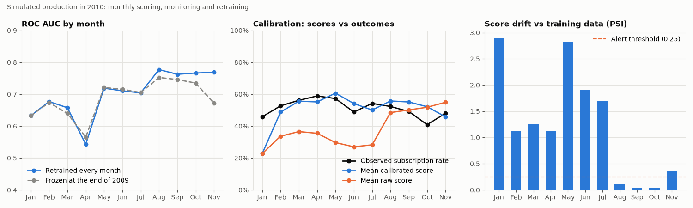

# :bank: Bank Marketing

Data science challenge: find which bank clients are most likely to subscribe to a term deposit, so that telemarketing calls go to the right people.

**Solution:** [notebook](Bank_Marketing.ipynb) · [production pipeline](#factory-production-pipeline)

<br>

## :question: Context

A Portuguese bank runs telemarketing campaigns to sell term deposits. Often more than one call to the same client is needed before the client decides whether to subscribe.

## :exclamation: Problem

**Predict whether a client will subscribe to a term deposit**, using a real-world dataset: explore the data, prepare it, build and evaluate a classification model, interpret the results, and assess how the model could be used in production.

## :computer: Resources

The public [Bank Marketing dataset](https://archive.ics.uci.edu/dataset/222/bank+marketing), also distributed on [Kaggle](https://www.kaggle.com/datasets/abdelazizsami/bank-marketing): 45,211 calls from May 2008 to November 2010, with 16 attributes of the client and the campaign, and the target `y` (the client subscribed). The data is not included in this repository.

> S. Moro, R. Laureano and P. Cortez. *Using Data Mining for Bank Direct Marketing: An Application of the CRISP-DM Methodology.* In P. Novais et al. (Eds.), Proceedings of the European Simulation and Modelling Conference – ESM'2011, pp. 117–121, Guimarães, Portugal, October 2011. EUROSIS.

## :rocket: Deliverables

Reproducible Python code (a Jupyter notebook) covering:

1. **Exploratory analysis:** basic statistics and data types, missing values and how they are handled, numeric and categorical distributions, and the relationship between the features and the target
2. **Preprocessing:** encoding, normalization or standardization (with justification), and the train/test split
3. **Modeling:** a classification model, with the choice of model and the parameter tuning justified
4. **Evaluation:** appropriate metrics (with justification) and explanatory charts
5. **Interpretation:** the most important features and actionable insights
6. **Production:** how the model could be used in production

## :gear: Running the notebook

The dependencies are managed with [uv](https://docs.astral.sh/uv/): `pyproject.toml` lists the packages and `uv.lock` pins the exact versions the notebook was run with (Python 3.14). uv installs Python 3.14 if it is missing.

```bash
cd Bank_Marketing
uv sync                            # create .venv with the locked versions
uv run jupyter lab
```

The data is not included in this repository. Download `bank-full.csv` from one of the links above and save it as `portfolio-data/Bank_Marketing/data/bank-full.csv`, in a `portfolio-data` folder next to this repository. The trained model is saved to `portfolio-data/Bank_Marketing/models/`. To use other locations, change `DATA_PATH` and `MODEL_PATH` in the notebook's setup cell.

## :factory: Production pipeline

Section 9 of the notebook describes how the model would run in production. The [`bank_marketing`](src/bank_marketing) package implements it as a monthly batch job. The notebook imports its date rebuilding, features and model definition from the same package, so analysis and production share one code base.

**The monthly job.** At the start of each month, it:

1. **Monitors the previous month**, whose call outcomes are now known: ROC AUC, subscription rate among the top 30% and by score decile, calibration, and drift of each feature and of the scores against the training data (population stability index, PSI).
2. **Retrains with champion/challenger.** Two training recipes compete: all history, or only the last 12 months. Each is fitted on the calls before the previous month and judged on it, and the challenger recipe replaces the champion's only if it ranks that month better. The winning recipe is refitted with the calls up to the new month and saved as a new model version.
3. **Recalibrates the scores** on the previous month's outcomes (Platt scaling), so they can be read as probabilities.
4. **Scores the new month's clients** with the champion.

Alerts are raised when ROC AUC falls below 0.60, a PSI exceeds 0.25, or the calibrated scores miss the observed rate by more than 10 points. Model versions are plain files with their metadata, and `champion.json` names the version in use. All file access goes through one module with configurable paths, so the same code can run on a local disk or on cloud storage.

**Simulated production in 2010.** The job was replayed month by month over 2010, starting from the notebook's final model:



- **Retraining helps, modestly:** the mean monthly ROC AUC is 0.702, against 0.687 for the model frozen at the end of 2009. The gain comes from August, when the last 12 months cover only the new, selective campaign.
- **Recalibration is essential:** until July, raw scores average 23% to 37% while about half of the clients subscribe. The calibrated scores track the observed rate from February on, within about 6 points in most months.
- **Drift alerts fire until the model trains on the new campaign:** the score PSI falls from above 1 to below 0.12 from August to October.

**Running it.** The commands below use the data and output folders described in the [main README](../README.md#information_source-about-the-data); `--data` and `--output` (or `BANK_MARKETING_DATA` and `BANK_MARKETING_OUTPUT`) change them.

```bash
cd Bank_Marketing
uv sync --group pipeline
uv run bank-marketing simulate                   # replay 2010 and save the reports and the chart
uv run bank-marketing train --before 2010-01     # or step by step: the first model...
uv run bank-marketing run-month 2010-01          # ...then one run at the start of each month
```

**Tests.** `uv sync --group test`, then `uv run pytest` and `uv run ruff check`. The tests use synthetic data. On every push, the CI also downloads the dataset from UCI and runs the simulation.

| Module | Role |
|---|---|
| `data.py`, `features.py`, `model.py` | Date rebuilding, features and model, shared with the notebook |
| `job.py` | The monthly job: monitoring, champion/challenger, recalibration, scoring |
| `monitor.py` | Ranking metrics, drift (PSI), calibration and alert thresholds |
| `registry.py` | Model versions and the champion |
| `simulation.py` | Replays the job over past months and draws the chart |
| `storage.py`, `config.py`, `cli.py` | File access, paths and command line |

<br>

[← Back to portfolio](../README.md)
