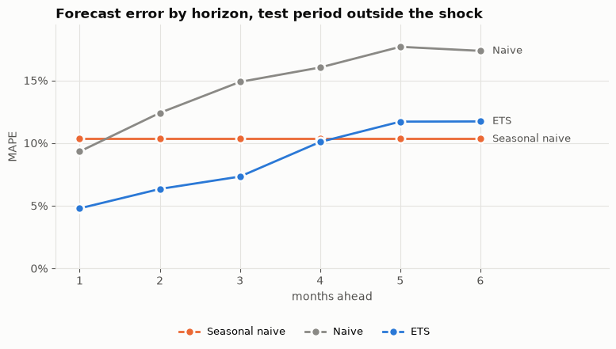
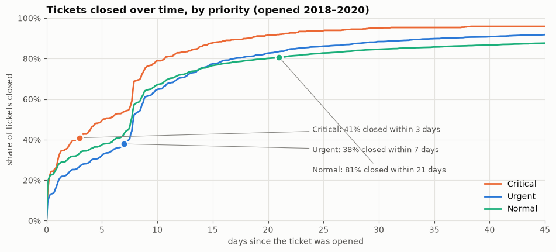
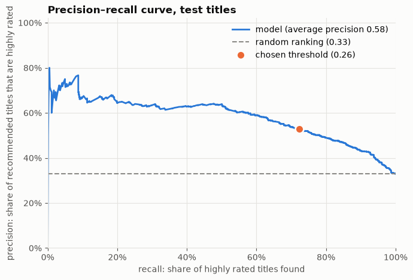

# Solano Jacon

Projects in data analysis, machine learning, time series forecasting and web development: from SQL extraction to models, business recommendations and a deployment-ready Django app.

**Stack:** Python (pandas, NumPy, scikit-learn, statsmodels, Matplotlib) · SQL (PostgreSQL, SQL Server) · Django · AWS (EC2, RDS, Elastic Beanstalk)

 

## :file_folder: Projects

| Project | Type | Key result |
| --- | --- | --- |
| [:moneybag: Lead Scoring for WhatsApp Campaigns](#moneybag-lead-scoring-for-whatsapp-campaigns) | Classification | Messaging half of the leads reaches **71% of buyers**; top 10% convert at **2x the average** |
| [:car: Vehicle Registration Forecast](#car-vehicle-registration-forecast) | Time series | **4.8% error one month ahead**, 40% less than the naive forecast |
| [:raising_hand: Customer Service Diagnosis](#raising_hand-customer-service-diagnosis) | Data analysis | Only **38% of urgent tickets** meet the customer's expectation; found why and what to change |
| [:movie_camera: Movie Rating Prediction](#movie_camera-movie-rating-prediction) | Classification | Top 10% of titles by score are **65% highly rated**, vs 33% at random |
| [:briefcase: Tasks & Notes](#briefcase-tasks--notes) | Web development | Multi-user Django app with per-user data isolation, covered by tests |

 

## :moneybag: Lead Scoring for WhatsApp Campaigns

**Problem:** A custom hair-care e-commerce company was spending heavily on WhatsApp messages sent to every lead who filled out its product questionnaire.

**Approach:** Extracted 428k leads from PostgreSQL and used only information available when a form is submitted, including each customer's earlier forms. Trained on January–April 2022 and tested on May–June to mirror real use. Compared a random baseline, logistic regression and gradient boosting with time-series cross-validation, and evaluated the ranking with ROC AUC, cumulative gains and lift.

**Result:** Only 12.7% of leads buy. Age, returning visits, device and acquisition channel separate buyers from non-buyers most clearly. The gradient boosting model ranks leads with a **ROC AUC of 0.67**. The **top 10% of leads convert at 29%**, about twice the average, and messaging the **top half reaches 71% of buyers** at half the cost. A cost analysis shows when cutting messages pays off.

`Python` `SQL` `PostgreSQL` `scikit-learn` `Gradient Boosting`

[Notebook](Lead_Scoring_for_WhatsApp_Campaigns/Lead_Scoring_for_WhatsApp_Campaigns.ipynb) · [Challenge description](Lead_Scoring_for_WhatsApp_Campaigns/README.md)

 

## :car: Vehicle Registration Forecast

**Problem:** Forecast monthly new-vehicle registrations in Brazil 1 to 6 months ahead, overall and by segment (passenger cars, light commercials, trucks, buses).

**Approach:** Modeled 19 years of ANFAVEA data (2002–2021) as registrations per working day, with Brazilian holidays in the calendar. Industry and retail indicators from IBGE were used only as they would have been published at forecast time. Compared naive baselines, exponential smoothing (ETS), SARIMA and Ridge regression with a rolling-origin backtest that refits every model each month. The model was chosen on forecasts for October 2012 to March 2018 and tested on April 2018 to March 2021.

**Result:** ETS was the most accurate. Outside the 2020 pandemic shock, it misses by **4.8% one month ahead and 11.7% six months ahead**. On average that is **40% less error than repeating the last month**, and about 15% less than repeating the same month last year. Once their publication delay was respected, the IBGE indicators improved the regression model only slightly: they did not beat ETS when the model was chosen and were only marginally ahead on the test period. The model beats the naive forecasts for every segment; buses are the hardest to predict.

`Python` `Time Series` `statsmodels` `scikit-learn` `Backtesting`

[Notebook](Vehicle_Registration_Forecast/Vehicle_Registration_Forecast.ipynb) · [Challenge description](Vehicle_Registration_Forecast/README.md)

 

## :raising_hand: Customer Service Diagnosis

**Problem:** A B2B software company faced widespread customer dissatisfaction with its ticket-based support. Customers expect resolution within 3, 7, and 21 days for critical, urgent, and normal tickets.

**Approach:** Extracted six tables from SQL Server and analyzed the 13,172 tickets opened in 2018–2020, including those still open. First checked which fields were reliable, then measured the share of tickets closed within the customer's expectation and the time to first answer. Traced who closed each ticket and when, and broke the delays down by type, system and customer.

**Findings:**

- Only **41% of critical and 38% of urgent tickets** meet the expectation, against 81% of normal ones, and the service got worse after 2018.
- **Priority barely changes the speed:** urgent and normal tickets take a median of 7.8 and 7.7 days.
- **35% of tickets are closed automatically** a week after the company's last answer. The recorded time therefore includes a week of waiting, and the customer never confirms the solution.
- **Answering is fast** (median of about half an hour or less on tickets the customer opened), **solving is slow.** One ticket type accounts for 71% of the late tickets, and ten customers open 82% of all tickets.
- The analysis ends with prioritized recommendations: priority queues, a new closing rule, data fixes, and indicators to monitor.

`Python` `SQL` `SQL Server` `pandas` `Matplotlib`

[Notebook](Customer_Service_Diagnosis/Customer_Service_Diagnosis.ipynb) · [Challenge description](Customer_Service_Diagnosis/README.md)

 

## :movie_camera: Movie Rating Prediction

**Problem:** A streaming company wants to know, before adding a movie or TV show to its catalog, whether audiences are likely to rate it well.

**Approach:** Cleaned a catalog of 6,234 titles. Ratings of 0 turned out to be missing values, and ratings had been matched by title, so different works with the same name shared one rating. Defined "highly rated" as 75 or more out of 100. Trained on titles added up to 2018 and tested on those added from 2019. Compared a baseline, logistic regression and gradient boosting with time-series cross-validation, chose the decision threshold on out-of-fold predictions, and evaluated the model with a confusion matrix and a precision–recall curve.

**Result:** A logistic regression on type, duration, release year and genre ranks titles with a **ROC AUC of 0.77**. **Of the titles it recommends, 53% are highly rated** (33% at random), and its **top 10% shortlist is 65% highly rated**. TV shows, longer movies, documentaries and stand-up are rated higher; kids' TV, reality TV and horror lower. Cast, director and synopsis added nothing, because each name appears in too few titles. The number of seasons was left out because it is recorded after the fact: shows that do well get renewed.

`Python` `scikit-learn` `Logistic Regression` `Classification`

[Notebook](Movie_Rating_Prediction/Movie_Rating_Prediction.ipynb) · [Challenge description](Movie_Rating_Prediction/README.md)

 

## :briefcase: Tasks & Notes

**What it is:** A multi-user web app for managing task lists (with subtasks) and notes. It has user registration and authentication, and each user can only see and change their own data.

**How it was built:** Django 5.2 with class-based views, server-rendered templates and Bootstrap 5. Ownership rules live in shared mixins, so the server always sets the owner and objects of other users return 404. Settings come from environment variables: SQLite locally, PostgreSQL in production. The app was deployed on AWS Elastic Beanstalk with RDS and is ready to deploy again. A test suite covers access control, task and subtask editing, and authentication.

`Python` `Django` `PostgreSQL` `Bootstrap` `HTML` `CSS` `AWS`

[Code and setup](Tasks_and_Notes)

 

## :information_source: About the data

The datasets used in the data science projects are not included in this repository. Every notebook is fully executed, so all code, outputs, metrics, and charts can be read directly on GitHub. Tasks & Notes needs no external data and runs locally with SQLite.

Each project manages its dependencies with [uv](https://docs.astral.sh/uv/): a `pyproject.toml` and a `uv.lock` that pins the exact versions it was run with (Python 3.14). Each README explains how to run it.
