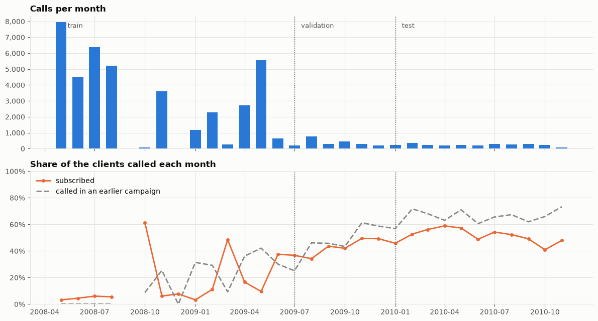
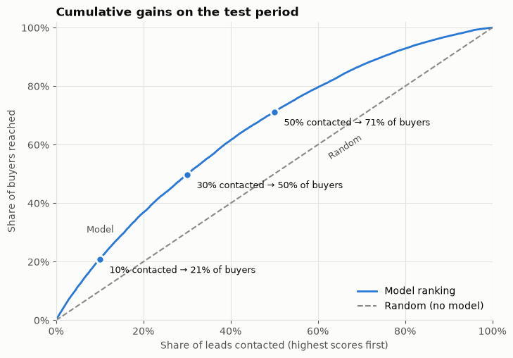
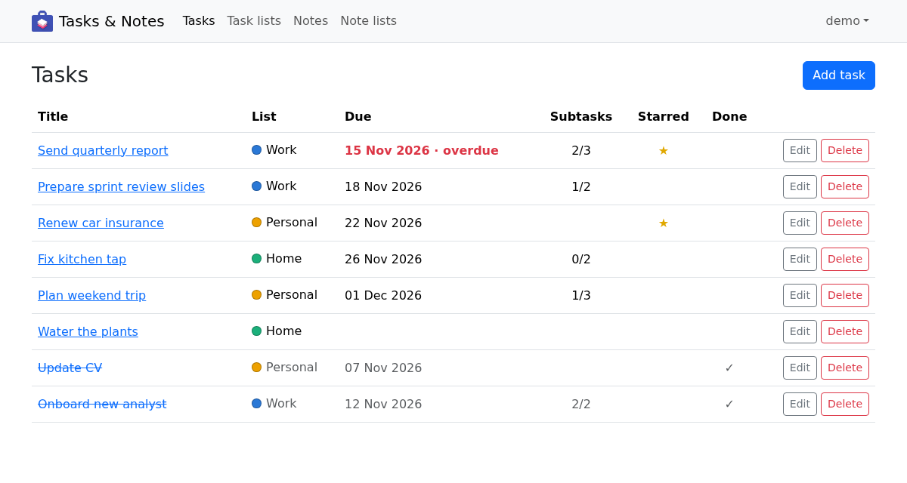

# Solano Jacon

Projects in machine learning, MLOps, time series forecasting, data analysis and web development: from SQL extraction to models, a tested monthly pipeline that monitors and retrains a model, business recommendations and a deployment-ready Django app.

**Stack:** Python (pandas, NumPy, scikit-learn, statsmodels, Matplotlib) · SQL (PostgreSQL, SQL Server) · pytest · GitHub Actions · uv · Django

 

## :file_folder: Projects

| Project | Type | Key result |
| --- | --- | --- |
| [:bank: Bank Marketing](#bank-bank-marketing) | Classification · MLOps | Calling the top 30% of clients reaches **44% of subscribers**, with **75% of calls converting** (52% at random) |
| [:moneybag: Lead Scoring for WhatsApp Campaigns](#moneybag-lead-scoring-for-whatsapp-campaigns) | Classification | Messaging half of the leads reaches **71% of buyers**; top 10% convert at **2x the average** |
| [:car: Vehicle Registration Forecast](#car-vehicle-registration-forecast) | Time series | **4.8% error one month ahead**, 40% less than the naive forecast |
| [:raising_hand: Customer Service Diagnosis](#raising_hand-customer-service-diagnosis) | Data analysis | Only **38% of urgent tickets** meet the customer's expectation; found why and what to change |
| [:movie_camera: Movie Rating Prediction](#movie_camera-movie-rating-prediction) | Classification | Top 10% of titles by score are **65% highly rated**, vs 33% at random |
| [:briefcase: Tasks & Notes](#briefcase-tasks--notes) | Web development | Multi-user Django app with per-user data isolation, covered by tests |

 

## :bank: Bank Marketing

**Problem:** rank bank clients by their chance of subscribing to a term deposit, before they are called.

- In mid-2009 the bank moved from mass calling to a few hundred selective calls a month. Validated by time, as it would run in production, the model reaches a **ROC AUC of 0.69**.
- Calling the **top 30% reaches 44% of subscribers**, and **75% of the calls convert** (52% at random).
- A success in the previous campaign is by far the strongest signal; repeated calls and loans lower the chances.
- **MLOps:** the model runs as a tested monthly batch job with monitoring, drift alerts, recalibration and champion/challenger retraining. A replay of 2010 runs in CI on every push.

`Python` `scikit-learn` `Logistic Regression` `Classification` `MLOps` `pytest` `GitHub Actions`

[Notebook](Bank_Marketing/Bank_Marketing.ipynb) · [Production pipeline](Bank_Marketing/README.md#factory-production-pipeline) · [Challenge description](Bank_Marketing/README.md)

 

## :moneybag: Lead Scoring for WhatsApp Campaigns

**Problem:** find which leads of a custom hair-care e-commerce company are most likely to buy, so that WhatsApp messages go to the right people.

- 428k leads extracted from PostgreSQL, using only what is known when a form is submitted. Trained on January–April 2022 and tested on May–June.
- A gradient boosting model ranks leads with a **ROC AUC of 0.67**: the **top 10% convert at 29%**, about twice the average.
- Messaging the **top half reaches 71% of buyers** at half the cost.

`Python` `SQL` `PostgreSQL` `scikit-learn` `Gradient Boosting`

[Notebook](Lead_Scoring_for_WhatsApp_Campaigns/Lead_Scoring_for_WhatsApp_Campaigns.ipynb) · [Challenge description](Lead_Scoring_for_WhatsApp_Campaigns/README.md)

 

## :car: Vehicle Registration Forecast

**Problem:** forecast monthly new-vehicle registrations in Brazil 1 to 6 months ahead, overall and by segment.

- 19 years of ANFAVEA data, modeled per working day, in a rolling backtest that refits every model each month.
- Exponential smoothing (ETS) misses by **4.8% one month ahead and 11.7% six months ahead** (outside the 2020 shock): **40% less error than repeating the last month**.
- IBGE indicators, used only as they would have been published, improved the regression model only slightly and did not beat ETS when the model was chosen. Buses are the hardest segment.

`Python` `Time Series` `statsmodels` `scikit-learn` `Backtesting`

[Notebook](Vehicle_Registration_Forecast/Vehicle_Registration_Forecast.ipynb) · [Challenge description](Vehicle_Registration_Forecast/README.md)

 

## :raising_hand: Customer Service Diagnosis

**Problem:** find out why the customers of a B2B software company are dissatisfied with its ticket-based support, and what to change.

- Only **41% of critical and 38% of urgent tickets** are closed within the customer's expectation (3 and 7 days), against 81% of normal ones. Priority barely changes the speed.
- **35% of tickets are closed automatically** a week after the last answer, so the recorded time includes a week of waiting.
- **Answering is fast, solving is slow.** One ticket type accounts for 71% of the late tickets, and ten customers open 82% of all tickets. The analysis ends with prioritized recommendations.

`Python` `SQL` `SQL Server` `pandas` `Matplotlib`

[Notebook](Customer_Service_Diagnosis/Customer_Service_Diagnosis.ipynb) · [Challenge description](Customer_Service_Diagnosis/README.md)

 

## :movie_camera: Movie Rating Prediction

**Problem:** predict, before adding a movie or TV show to a streaming catalog, whether audiences will rate it well.

- Ratings of 0 turned out to be missing, and titles with the same name shared one rating; both cases were removed before modeling.
- A logistic regression on type, duration, release year and genre reaches a **ROC AUC of 0.77**; its **top 10% shortlist is 65% highly rated** (33% at random).
- TV shows, documentaries and stand-up are rated higher. Cast and director added nothing, because each name appears in too few titles.

`Python` `scikit-learn` `Logistic Regression` `Classification`

[Notebook](Movie_Rating_Prediction/Movie_Rating_Prediction.ipynb) · [Challenge description](Movie_Rating_Prediction/README.md)

 

## :briefcase: Tasks & Notes

**What it is:** a multi-user Django app for task lists (with subtasks) and notes, where each user can only see and change their own data.

- Ownership rules live in shared mixins: the server always sets the owner, and other users' objects return 404.
- SQLite locally, PostgreSQL in production; ready to deploy on AWS Elastic Beanstalk.
- A test suite, run on every push, covers access control, editing and authentication.

`Python` `Django` `PostgreSQL` `Bootstrap` `HTML` `CSS`

[Code and setup](Tasks_and_Notes)

 

## :information_source: About the data

The datasets used in the data science projects are not included in this repository. Every notebook is fully executed, so all code, outputs, metrics, and charts can be read directly on GitHub. Tasks & Notes needs no external data and runs locally with SQLite.

The notebooks expect the data in a `portfolio-data` folder next to this repository, with one folder per project: for example, `portfolio-data/Bank_Marketing/data/bank-full.csv`. Saved models are written to a `models` folder inside the project's folder there. To use another location, change the paths in the notebook's setup cell.

Each project manages its dependencies with [uv](https://docs.astral.sh/uv/): a `pyproject.toml` and a `uv.lock` that pins the exact versions it was run with (Python 3.14). Each README explains how to run it.
